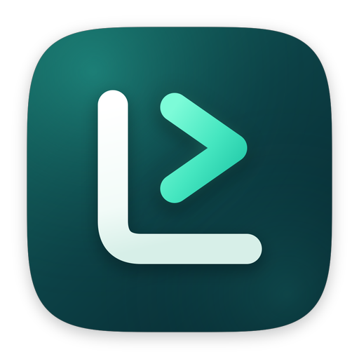
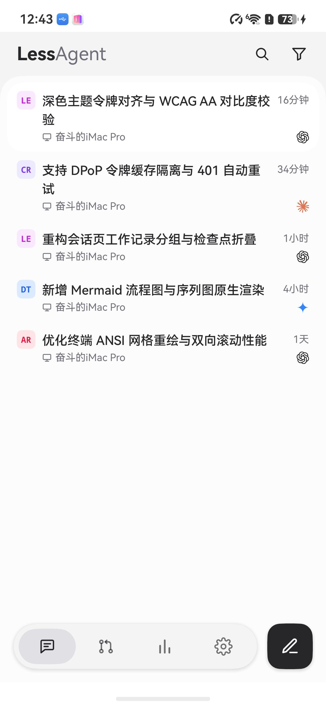
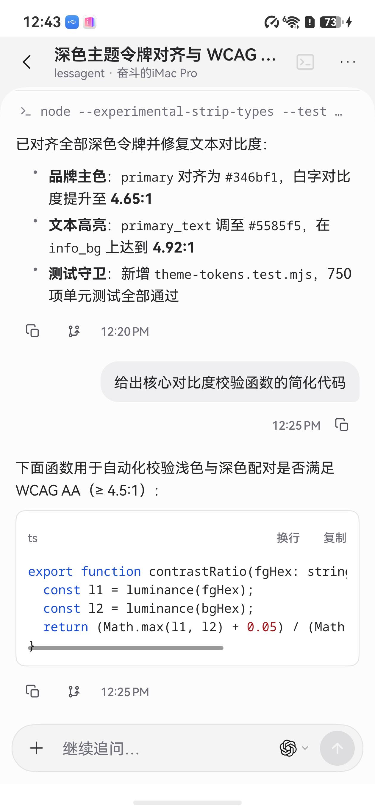
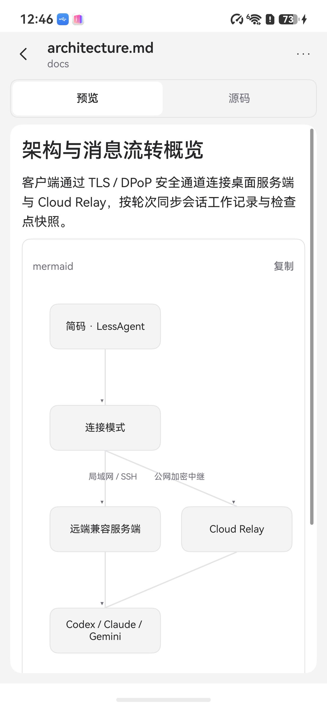
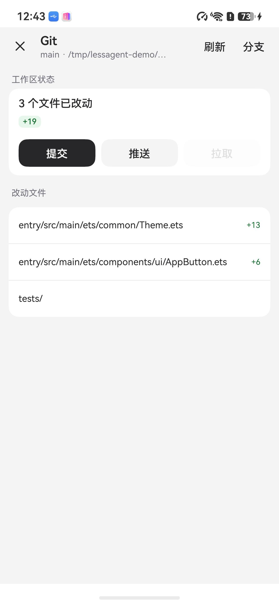
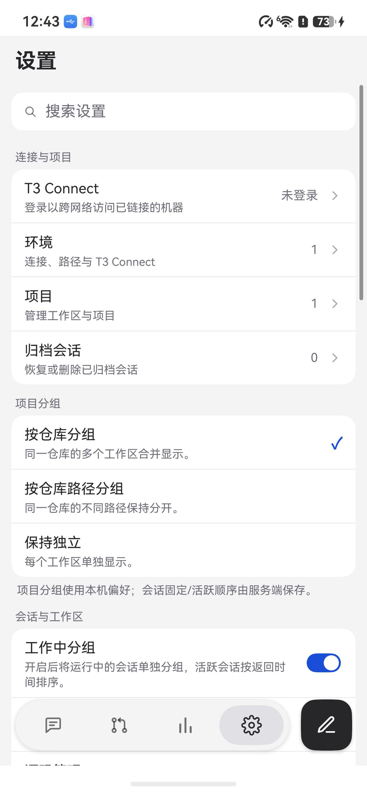
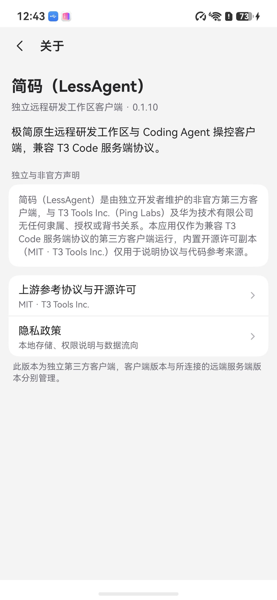
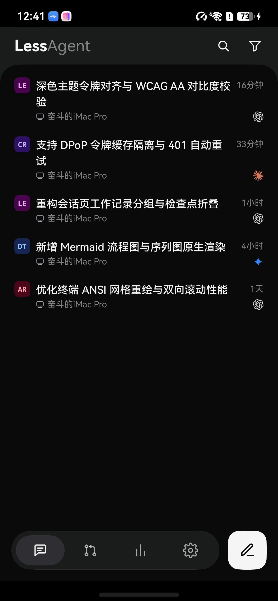
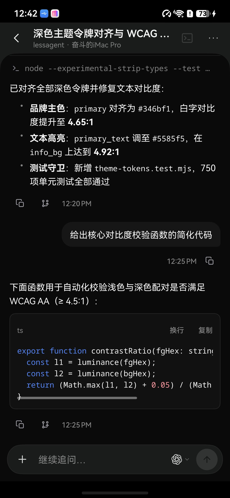

<div align="center">

<p>
  
</p>

<h1>LessAgent (简码)</h1>

<p>
  An independent, unofficial third-party native HarmonyOS client for <strong>T3 Code</strong> built with <strong>ArkTS + ArkUI</strong> —<br />
  connect to your desktop or remote T3 Code server to drive coding agents, inspect diffs, and operate dev tools from your phone.
</p>

<p>
  
  
  <a href="https://github.com/DASungta/lessagent/releases/tag/v0.1.12-preview"></a>
  
  
</p>

<p>
  <a href="README.md">简体中文</a> · <strong>English</strong>
</p>

<p>
  <a href="#independent--unofficial-notice">Disclaimer</a> ·
  <a href="#screenshots">Screenshots</a> ·
  <a href="#features">Features</a> ·
  <a href="#quick-guide">Quick Guide</a> ·
  <a href="#development--build">Development &amp; Build</a> ·
  <a href="#project-structure">Project Structure</a> ·
  <a href="#documentation">Documentation</a>
</p>

</div>

---

> ### Independent & Unofficial Notice
> **LessAgent (简码)** is an **independent, unofficial third-party open-source client** (`com.dasungta.lessagent`). It is **not affiliated with, endorsed by, or sponsored by T3 Tools Inc. (Ping Labs) or Huawei Technologies Co., Ltd.**
> - LessAgent implements compatibility with the [T3 Code](https://github.com/pingdotgg/t3code) server protocol (`orchestrationProtocol=2`). The bundled [MIT license copy](entry/src/main/resources/rawfile/t3code-license.txt) is included for upstream protocol/code attribution.
> - Optional compatibility with the upstream hosted **T3 Connect** relay is supported on a best-effort basis with **no upstream long-term stability guarantees**. You can switch to a **self-hosted relay** or use **direct LAN / Tailnet / HTTPS pairing** at any time.

**LessAgent (简码)** is an independent, unofficial third-party native HarmonyOS client for [T3 Code](https://github.com/pingdotgg/t3code) designed for controlling remote development workspaces and coding agents. Running as a thin client, all coding agent execution and repository operations stay on your desktop or remote server while the phone delivers a responsive native ArkUI experience verified on real hardware.

## Screenshots

| Home Workbench | Chat & Code Highlighting | File Browser & Native Mermaid | Git Status & Commit |
| :---: | :---: | :---: | :---: |
|  |  |  |  |

| Grouped Settings | About & Notice | Home Workbench (Dark) | Chat Detail (Dark) |
| :---: | :---: | :---: | :---: |
|  |  |  |  |

> Real-device screenshots captured from **LessAgent (简码) `v0.1.10`** against an isolated test server and demo repository fixture across Light and Dark themes.

## Features

- **Multi-Environment Workbench & Thread Management**
  - Direct pairing over LAN, SSH, Tailnet, or loopback (manual entry, QR code scan, `lessagent://` and compatible `t3code://` deep links), plus optional T3 Connect / custom self-hosted Cloud Relay compatibility (`OAuth + PKCE + DPoP`).
  - Floating bottom bar (`Chats / Pull Requests / Usage / Settings`) paired with a quick **New Task** action; repository/path/flat thread grouping, search, environment & project filters, pin, snooze, settle, archive, and multi-draft restoration.
- **Native Chat & Rich Media Rendering**
  - Pure ArkUI message timeline with turn-grouped collapsible work logs & checkpoints, subagent thread inspection, and approval / secret request cards.
  - Native Markdown rendering, syntax-highlighted code blocks (adjustable font size `8–18` and word wrap), LaTeX math, and native ArkUI Mermaid diagrams (flowchart, sequence, class, and state diagrams), plus built-in offline Chinese voice dictation for drafts.
- **Mobile Developer Toolbox**
  - Workspace file browser and full-text search, line-selectable Diff viewer with inline review comments, and full Git workflows (status, stage, commit, branches, push/pull).
  - GitHub Pull Requests reader / review / guide tour, one-tap remote ANSI terminal in the chat top bar (with scrollback & copy), remote browser preview, and iOS Simulator / Android Emulator device preview.
- **Design System & Native System Integration**
  - 112 symmetric Light/Dark semantic color tokens (`base/element/color.json` & `dark/element/color.json`) guarded by automated WCAG AA (`>= 4.5:1`) contrast tests.
  - Localized app identity (`简码` in Simplified Chinese, `LessAgent` in English), system share sheet integration to import images and files into task drafts, plus a `2×2` home-screen shortcut widget and launcher quick actions.

## Quick Guide

| Action | Where to Start |
|---|---|
| **Start a task or resume a chat** | Tap the **New Task** button at the bottom-right of the floating bar, or select an existing thread. Switch environment, project, model, and mode beneath the composer. |
| **Manage connected environments** | Tap the `LessAgent` wordmark in the top-left of the home screen to pair manually, scan a QR code, import a deep link, or manage multiple routes. |
| **Search & filter threads** | Use the search or filter icon in the home top-right bar to search across threads or scope by environment and project. |
| **Files, Diff, Git, PRs, Terminal & Preview** | Inside a chat, tap the terminal icon in the top bar for direct shell access, or open **More** (`···`) for Files, Diff, Git, Pull Requests, Browser Preview, and Device Preview. |
| **Import via system share sheet** | Pick an image or file in Gallery / Files → Share → **LessAgent** (`简码` in Chinese), verify the preview and target project, and save it as a draft. |
| **Dictate drafts in Chinese** | Open **Tools → Voice Input** in the chat composer to transcribe spoken Chinese directly into the input box. |
| **Code typography, projects, worktrees & schedules** | Switch to the **Settings** tab at the bottom to configure code font size (`8–18`) / word wrap, add projects, manage source control, override per-project worktree settings, create scheduled tasks, and switch themes. |

## Development & Build

### Download Preview Sideload Package

This project is currently in **Preview**. You can download the prebuilt **unsigned debug-mode HAP** (`lessagent-v0.1.12-preview-unsigned.hap`, with its `.sha256` checksum, bundle `com.dasungta.lessagent`, API `20+`) from [GitHub Releases (`v0.1.12-preview`)](https://github.com/DASungta/lessagent/releases/tag/v0.1.12-preview).

> **Sideloading Note**: Devices reject unsigned HAPs as well as debug packages signed for another device's UDID. Sign unsigned packages with your own developer certificate/profile, or clone the repo and build with automatic signing for `com.dasungta.lessagent` in DevEco Studio.

### Prerequisites

- **DevEco Studio 6.1.1+** with SDK `6.1.1(24)` (`API 24+`)
- **Node.js 22+** (required for `--experimental-strip-types` host unit tests)
- A running compatible server (such as a [T3 Code](https://github.com/pingdotgg/t3code) server) on your desktop or remote machine

### Testing & Building

```bash
git clone https://github.com/DASungta/lessagent.git
cd lessagent

# Run all host unit tests and theme contrast checks (774/774)
node --experimental-strip-types --test tests/*.test.mjs

# Build the Debug HAP (override DevEco Studio path via DEVECO_HOME if needed)
./scripts/build.sh
```

> **Signing Note**: The bundle name is now `com.dasungta.lessagent`. Before installing onto a physical device or building a release package, generate and configure your own debug/release signing certificate and profile for `com.dasungta.lessagent` in DevEco Studio / AGC. Never commit personal certificates or keys to public repositories.

## Project Structure

```text
lessagent/
├── AppScope/                         # App metadata (com.dasungta.lessagent), layered icon & localized names
│   └── resources/{base,zh_CN,en_US}/ # Localized app_name ("简码" / "LessAgent")
├── entry/src/main/
│   ├── ets/
│   │   ├── common/                   # Theme.ets (typography, spacing, radius & size tokens)
│   │   ├── components/               # Feature panels and ui/ shared design-system components
│   │   ├── pages/                    # Main entry page Index.ets
│   │   ├── protocol/                 # Server protocol compatibility, reducers, Markdown/Diff/Mermaid parsers
│   │   ├── services/                 # Networking, pairing/auth, remote terminal & OS bridges
│   │   ├── storage/                  # Local preferences, profiles & draft persistence
│   │   ├── entryability/             # Main Ability, share sheet & deep-link handlers (lessagent:// & t3code://)
│   │   └── formextension/            # 2×2 home-screen widget extension
│   └── resources/
│       ├── base/element/color.json   # Light theme: 112 semantic color tokens
│       ├── dark/element/color.json   # Dark theme: 112 semantic color tokens
│       ├── {base,zh_CN,en_US}/       # Localized permission reasons & shortcut labels
│       └── rawfile/                  # Bundled attribution license & relay compatibility defaults
├── scripts/                          # Build/release scripts, replay helpers & device keep-awake tool
├── tests/                            # Host unit tests & Light/Dark WCAG AA contrast checks
└── docs/                             # Brand logo (assets/), design system, plans, shots & evidence
```

## Documentation

- **Design & Visual System**: [Design System & Tokens](docs/design/README.md) · [Interactive Style Guide](docs/design/style-guide.html) · [Visual Refresh Device Evidence (Steps 2–6b)](docs/evidence/visual-refresh)
- **Progress & Roadmap**: [Development Status](docs/development-status.md) · [Full Mobile Migration Plan (R0–R8)](docs/full-mobile-migration-plan.md)
- **Reference Ledgers**: [Mobile Capability Matrix](docs/r0-mobile-capability-matrix.md) · [Route Ledger](docs/r0-route-ledger.md) · [R6–R8 Acceptance](docs/r6-r8-acceptance.md)
- **Device Tooling & Handoff**: [Device Keep-Awake Guide](docs/device-keep-awake.md) · [Developer Handoff Notes (ZH)](docs/开发交接.md)

## Scope & Status

Core end-to-end mobile workflows and the visual refresh have been verified on real hardware. External-dependency edge cases (such as an external iOS Simulator host, full physical Bluetooth keyboard coverage, self-hosted production cloud-relay deployment, and tablet/foldable multi-form-factor matrices) remain tracked in the documentation; host unit tests do not replace real-device verification.

## Protocol Compatibility & License

- Compatible upstream protocol reference: [pingdotgg/t3code](https://github.com/pingdotgg/t3code) · [DASungta/t3code](https://github.com/DASungta/t3code) (independent, unofficial third-party client)
- License: [MIT License](entry/src/main/resources/rawfile/t3code-license.txt) (bundled license copy).
