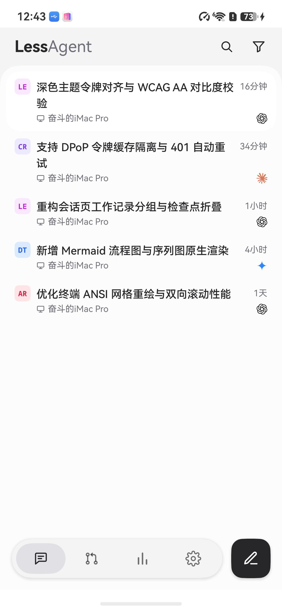
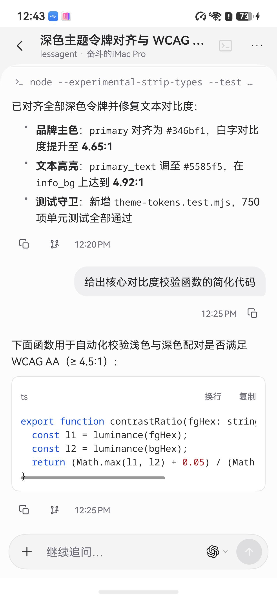
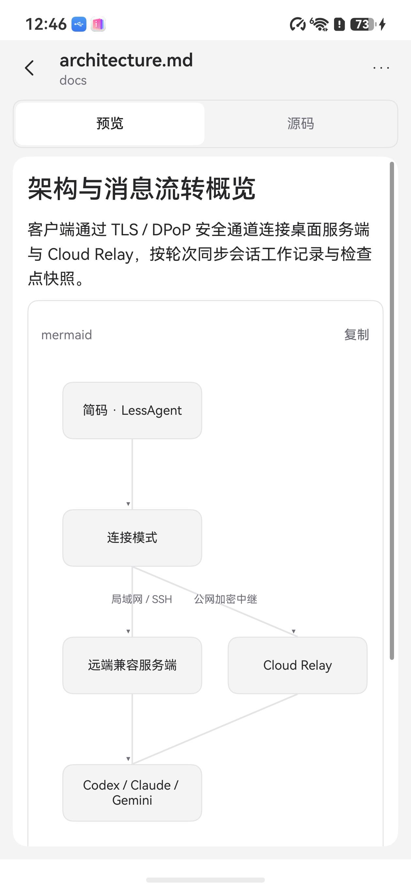
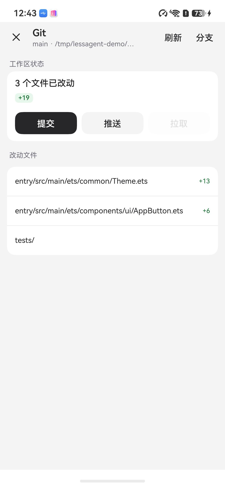
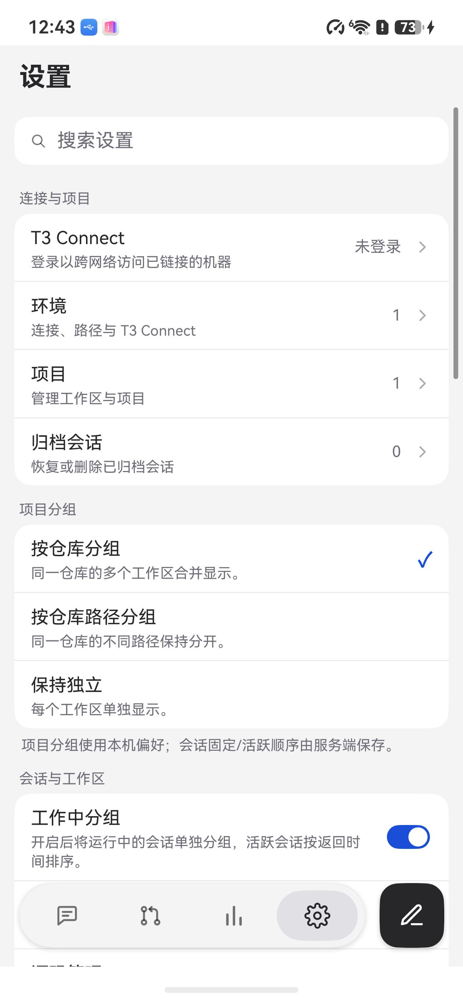
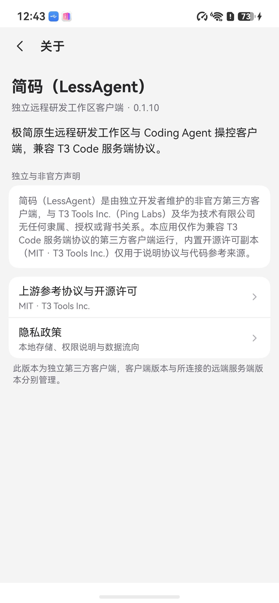
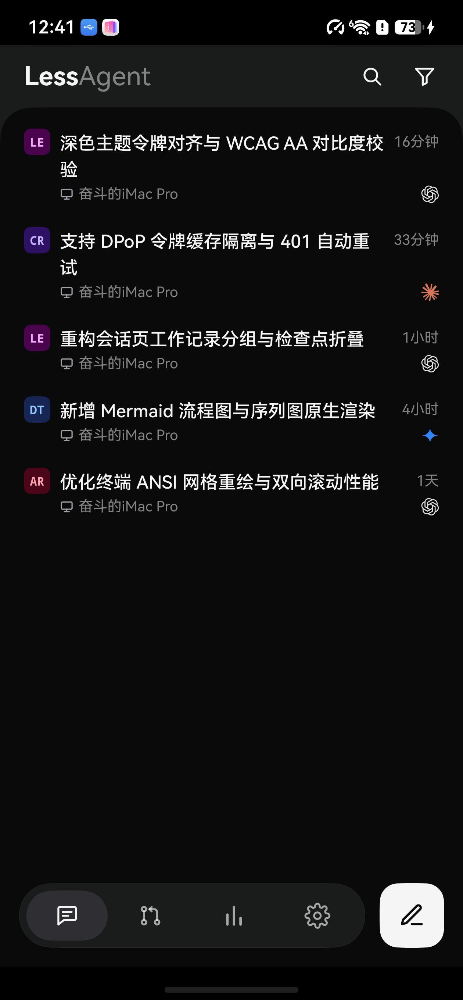
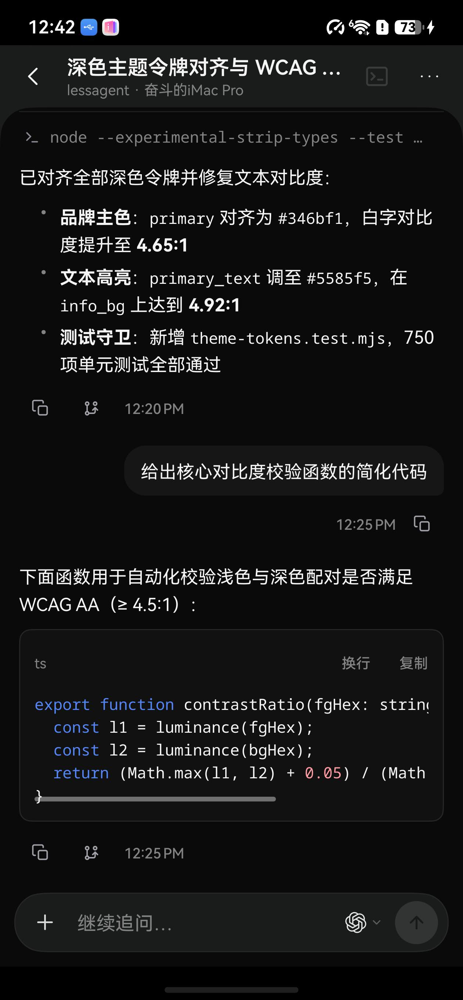

<div align="center">

<p>
  
</p>

<h1>简码 · LessAgent</h1>

<p>
  基于 <strong>ArkTS + ArkUI</strong> 打造的独立第三方 <strong>T3 Code</strong> 鸿蒙原生客户端 ——<br />
  直连电脑或服务器端的 T3 Code 服务端，随时随地驱动 Coding Agent、审阅变更与操作研发工具。
</p>

<p>
  
  
  <a href="https://github.com/DASungta/lessagent/releases/tag/v0.1.12-preview"></a>
  
  
</p>

<p>
  <strong>简体中文</strong> · <a href="README.en.md">English</a>
</p>

<p>
  <a href="#独立与非官方声明">独立声明</a> ·
  <a href="#界面预览">界面预览</a> ·
  <a href="#核心特性">核心特性</a> ·
  <a href="#日常使用">日常使用</a> ·
  <a href="#本地开发与构建">本地开发与构建</a> ·
  <a href="#项目结构">项目结构</a> ·
  <a href="#工程文档">工程文档</a>
</p>

</div>

---

> ### 独立与非官方声明
> **简码（LessAgent）** 是由独立开发者维护的**非官方第三方开源客户端**（包名 `com.dasungta.lessagent`），与 **T3 Tools Inc.（Ping Labs）** 及 **华为技术有限公司** 无任何隶属、授权、合作或背书关系。
> - 本客户端兼容 [T3 Code](https://github.com/pingdotgg/t3code) 服务端协议（`orchestrationProtocol=2`），内置的 [MIT 许可证副本](entry/src/main/resources/rawfile/t3code-license.txt) 仅用于说明协议与代码参考来源。
> - 应用支持兼容接入上游托管中继服务 **T3 Connect**，但上游不承诺第三方客户端的长期接口稳定性；您可随时切换**自建中继**或使用**局域网 / Tailnet / 公网直连**模式。

**简码（LessAgent）** 是一款独立维护的非官方第三方 [T3 Code](https://github.com/pingdotgg/t3code) 鸿蒙原生客户端，用于远程操控研发工作区与 Coding Agent。架构上作为瘦客户端运行，所有 Coding Agent 执行与仓库操作均在您的电脑或远端服务端完成；全套页面、会话流、Markdown、代码高亮、Mermaid 图表、HTML / 富文件预览与 Diff 审阅均以原生 ArkUI 实现，并在真机上完成端到端联调与视觉打磨。

## 界面预览

| 首页工作台 | 会话与代码高亮 | 文件浏览与原生 Mermaid | Git 变更与提交 |
| :---: | :---: | :---: | :---: |
|  |  |  |  |

| 分组设置中心 | 关于与独立声明 | 深色首页工作台 | 深色会话详情 |
| :---: | :---: | :---: | :---: |
|  |  |  |  |

> 以上真机预览截图采集自 **简码 · LessAgent `v0.1.10`**（连接隔离测试环境与演示仓库数据，涵盖浅色与深色模式）。

## 核心特性

- **多环境工作台与会话管理**
  - 支持局域网 / SSH / Tailnet / 回环地址直连配对（手动输入、扫码、`lessagent://` 及兼容 `t3code://` 深链），支持多环境互链管理，并兼容接入上游 T3 Connect（邮箱 / OTP / 2FA / SSO 登录、`OAuth + PKCE + DPoP`）或自建云中继。
  - 底部悬浮四栏（`会话 / 拉取请求 / 用量 / 设置`）与新建任务快捷入口；支持仓库、路径与平铺分组、全文搜索、环境与项目筛选、置顶、稍后提醒（Snooze）、Settle、归档、多草稿恢复，以及模型搜索、收藏与按 Provider / 旧模型筛选。
- **原生会话、输入体验与富媒体渲染**
  - 纯 ArkUI 对话消息流、按轮次分组的可折叠工作日志与检查点、子 Agent 线程查看、工具审批 / Agent 反馈 / 密钥请求卡片；底部**悬浮状态胶囊**实时展示运行进度、子智能体、消息队列与**网页操控状态**，支持一键跳转远端浏览器控制页。
  - 支持 **1–6 行自适应滚动输入框**、统一 **`@` 上下文提及**（近期与全局会话、工作区文件、已连环境、模型，支持气泡内点击跳转 `t3-context://`）、图片缩略图与文件卡片附件预览条，以及内置中文离线语音口述草稿。
  - 原生支持 Markdown（含嵌套/混排列表标号与长文档分块渲染）、代码语法高亮（8–18 号字号与长行自动换行）、LaTeX 数学公式、原生 ArkUI Mermaid 图表（流程图、时序图、类图、状态图）、内联与全屏 **HTML（`html_render`）** 与 **MCP App** 沙箱预览，以及富媒体保存与分享。
- **移动端研发工具箱**
  - 随时浏览工作区文件与全文检索，支持 **Markdown、HTML 实时/源码切换预览、PDF、ZIP 目录浏览、CSV/TSV 表格、RTF、图片 / 视频 / 音频** 等多格式预览与大文件（≤ 8 MiB）后台加载；文件与 HTML 预览支持独立原生滚动隔离，返回会话时保持原有阅读位置不跳顶。
  - 查看支持选行、行内词级高亮与行级评论的 Diff；执行 Git 状态检查 / 暂存 / 提交 / 分支切换 / 推送拉取。
  - 支持 GitHub Pull Requests 阅读 / 评审 / Guide 导览（`Viewed` 已阅标记、Saved Views、自动合并与 Stack 整栈合并、PR Agent 快捷任务）、会话顶栏直达的远端 ANSI 终端（含回滚与复制）、MCP OAuth 登录、远端浏览器预览与 iOS Simulator / Android Emulator 设备预览。
- **设计系统与原生系统集成**
  - 内置 112 组深浅色对称语义颜色令牌（`base/element/color.json` 与 `dark/element/color.json`），WCAG AA（≥ 4.5:1）对比度由自动化测试守门。
  - 支持中英文多语言应用名（简体中文「简码」/ 英文 `LessAgent`）、系统分享面板直接导入图片与文本为任务草稿，并提供 `2×2` 桌面快捷卡片与图标长按快捷入口。

## 日常使用

| 要做的事 | 从哪里进入 |
|---|---|
| **新建任务或继续会话** | 点击底部悬浮栏右下角「新建任务」按钮，或点选已有会话；输入区支持 1–6 行自动增高滚动，下方可切换环境、项目、模型（支持搜索/收藏）与模式。 |
| **`@` 上下文提及与附件预览** | 在输入框键入 `@` 或打开底部面板即可引用会话、工作区文件、环境或模型；添加的图片与文件会以缩略图/卡片展示在输入区上方并支持点开预览。 |
| **管理连接环境** | 点击首页左上角 `LessAgent` 字标，支持手动配对、扫码、深链导入、多连接路径与跨环境互链管理。 |
| **搜索与筛选会话** | 点击首页右上角搜索图标检索会话，或点击筛选图标按环境与项目过滤。 |
| **文件、Diff、Git、PR、终端与预览** | 进入会话后，顶栏可直接打开「终端」，右上角「更多」可进入文件（含 HTML / PDF / ZIP / CSV / 音视频预览）、Diff、Git、拉取请求、浏览器预览与设备预览；Agent 操控网页时，点击底部**悬浮状态胶囊**即可一键跳转控制页。 |
| **从系统分享导入附件** | 在相册或文件管理中选择文件 → 分享 →「简码」（英文环境为 **LessAgent**），核对预览并选择目标项目后存为草稿。 |
| **中文语音口述草稿** | 在会话输入区打开「工具 → 语音输入」，语音识别完成后自动写入输入框。 |
| **代码阅读、项目、工作树与定时任务** | 切换到底部「设置」标签页，按分组配置代码字号（8–18）/ 自动换行、添加项目、源码管理、工作树项目级覆盖、定时任务与深浅色主题。 |

## 本地开发与构建

### 下载预览侧载包

当前项目处于 **Preview** 阶段，可直接前往 [GitHub Releases (`v0.1.12-preview`)](https://github.com/DASungta/lessagent/releases/tag/v0.1.12-preview) 下载预编译的 **未签名调试模式 HAP**（`lessagent-v0.1.12-preview-unsigned.hap`，附 `.sha256` 校验文件，包名 `com.dasungta.lessagent`，兼容 `HarmonyOS API 20+`）；同步构建的 `0.1.12 (13)` 正式发布包已提交至华为应用市场（AGC）邀请测试。

**`v0.1.12-preview` 近期更新要点（含 `v0.1.11`）：**
- **悬浮胶囊网页操控标识**：会话底部悬浮状态胶囊实时展示远端浏览器预览与 Agent 操控状态，点击即可一键跳转浏览器控制页。
- **文件与 HTML 预览滚动隔离**：修复 Markdown、代码、HTML 等预览页滚动穿透到底层会话列表及边缘阻尼异常，返回会话后完整保留当前浏览位置不再闪回顶部。
- **输入体验与 `@` 提及升级**：支持 1–6 行自适应滚动输入与附件缩略图/文件卡片预览；新增会话 / 文件 / 环境 / 模型全量 `@` 提及与 `t3-context://` 点击跳转；修复 Markdown 嵌套列表标号与空闲子智能体状态残留。

> **侧载说明**：出于系统安全机制，真机拒绝直接安装未签名包，而调试签名强绑定单台设备 UDID 与个人证书。下载未签名包后，请使用您自己的开发者账号注入调试签名后安装，或直接克隆源码在 DevEco Studio 中为 `com.dasungta.lessagent` 开启自动签名编译安装。

### 环境要求

- **DevEco Studio 6.1.1+（Release 版）** 与 SDK `6.1.1(24)`（`release` 产物兼容 `API 20+` / `6.0.0(20)`–`6.1.1(24)`，`default` 调试产物目标 `6.1.1(24)`）
- **Node.js 22+**（用于运行 `--experimental-strip-types` 宿主单元测试）
- 电脑或服务器上运行中的兼容服务端（例如 [T3 Code](https://github.com/pingdotgg/t3code) 服务端）

### 运行测试与构建 HAP

```bash
git clone https://github.com/DASungta/lessagent.git
cd lessagent

# 运行全部宿主单元测试与主题对比度校验（774/774）
node --experimental-strip-types --test tests/*.test.mjs

# 构建 Debug HAP（可通过 DEVECO_HOME 指定 DevEco Studio 安装路径）
./scripts/build.sh

# 构建兼容 API 20+ 的签名 Release .app（需配置发布签名环境）
./scripts/build-release.sh
```

> **签名提示**：包名已切换为 `com.dasungta.lessagent`。如需打包安装到真机或构建发布包，请在 DevEco Studio / AGC 中为 `com.dasungta.lessagent` 配置您自己的调试与发布签名证书及 Profile，切勿向公开仓库提交个人签名文件与密钥。

## 项目结构

```text
lessagent/
├── AppScope/                         # 应用元信息 (com.dasungta.lessagent)、分层图标与中英文名称
│   └── resources/{base,zh_CN,en_US}/ # 简体中文「简码」与英文「LessAgent」多语言资源
├── entry/src/main/
│   ├── ets/
│   │   ├── common/                   # Theme.ets（字号、行高、间距、圆角与尺寸令牌）
│   │   ├── components/               # 业务面板、HTML/MCP 视图、悬浮状态胶囊与 ui/ 基础组件
│   │   ├── pages/                    # 主入口页面 Index.ets
│   │   ├── protocol/                 # 服务端协议、状态派生、Markdown/Diff/Mermaid/HTML/提及解析
│   │   ├── services/                 # 网络通信、配对认证、远端终端与系统能力桥接
│   │   ├── storage/                  # 本地偏好设置、连接档案与草稿持久化
│   │   ├── entryability/             # 主 Ability 与系统分享 / 深链接入 (lessagent:// & t3code://)
│   │   └── formextension/            # 2×2 桌面快捷卡片扩展
│   └── resources/
│       ├── base/element/color.json   # 浅色主题 112 组语义颜色令牌
│       ├── dark/element/color.json   # 深色主题 112 组语义颜色令牌
│       ├── {base,zh_CN,en_US}/       # 中英文权限说明与快捷入口文案
│       └── rawfile/                  # 内置参考开源许可证与中继兼容预设
├── scripts/                          # 构建脚本、发布脚本与联调工具
├── tests/                            # 宿主单元测试与深浅色对比度校验
└── docs/                             # Brand Logo (assets/)、设计规范、迁移计划与验证证据
```

## 工程文档

- **设计与视觉**：[设计规范与令牌文档](docs/design/README.md) · [可视化风格指南](docs/design/style-guide.html) · [视觉重构真机证据（Step 2–6b）](docs/evidence/visual-refresh)
- **项目进度与计划**：[整体开发状态与真机记录](docs/development-status.md) · [完整移动端迁移计划（R0–R8）](docs/full-mobile-migration-plan.md)
- **对照台账与验收**：[移动端能力矩阵](docs/r0-mobile-capability-matrix.md) · [路由台账](docs/r0-route-ledger.md) · [R6–R8 验收记录](docs/r6-r8-acceptance.md)
- **调试与交接**：[真机调试常亮指南](docs/device-keep-awake.md) · [开发交接说明](docs/开发交接.md)

## 当前边界

当前主链路能力与全站视觉重构已完成真机联调，但部分依赖外部运行环境的边缘场景（例如外接 iOS Simulator 宿主机、实体蓝牙键盘快捷键全覆盖、独立生产级云中继服务部署以及平板 / 折叠屏多形态响应式矩阵）仍在文档中持续跟踪；宿主单元测试通过亦不能替代完整真机与端到端联调验收。

## 兼容协议来源与开源协议

- 兼容协议参考：[pingdotgg/t3code](https://github.com/pingdotgg/t3code) · [DASungta/t3code](https://github.com/DASungta/t3code)（本项目为独立非官方第三方客户端）
- 开源协议：遵循 [MIT License](entry/src/main/resources/rawfile/t3code-license.txt)（应用内置许可证副本）。
